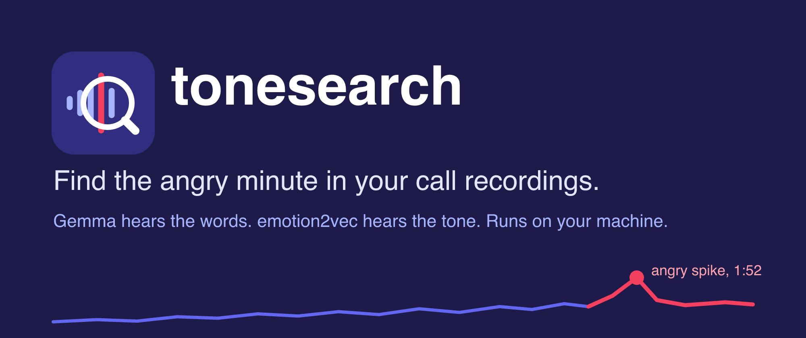

<p align="center"></p>

# tonesearch

Search call recordings by **what** was said and **how** it was said. Runs locally. No transcript needed.

- What: EmbeddingGemma 2 embeds the audio, so a text query finds speech by meaning.
- How: emotion2vec+ scores each segment for tone (angry, sad, happy, ...).
- Timeline: tone over time for one call, with the top 3 spikes.

Validation numbers: [RESULTS.md](RESULTS.md).

## Where

| File | What |
|---|---|
| `tonesearch.py` | Indexer, search, CLI, Gradio UI |
| `make_demo.py` | Builds whole-call demo WAVs from HaessigDB |
| `test_tonesearch.py` | Self-check on the demo index |
| `eval_tone.py`, `probe_tone.py`, `probe_e2v.py` | Research scripts behind RESULTS.md |

## How

```sh
pip install -e .
tonesearch index <audio dir> <index dir>          # any .wav .mp3 .flac .m4a .ogg, resampled to 16 kHz mono
tonesearch search <index dir> "refund request" --tone angry --w 1
tonesearch search <index dir> --tone angry        # tone only
tonesearch ui <index dir>                         # Gradio at http://127.0.0.1:7860
```

Score per segment: `z(cosine to query) + w * z(tone score)`. `w = 0` searches words only.

Demo on HaessigDB (CC-BY-4.0, download from Zenodo record 18745894):

```sh
python -I make_demo.py <haessig dir>
tonesearch index <haessig dir>/calls <haessig dir>/index
python -I test_tonesearch.py <haessig dir>
tonesearch ui <haessig dir>/index
```

License note: emotion2vec+ uses the FunASR model license. Check its commercial terms before a paid product.

## Static Space (live)

Live demo: https://huggingface.co/spaces/pradachan/tonesearch. `space-static/` is one `index.html`. It embeds the query in the browser (transformers.js, EmbeddingGemma 2 ONNX q4) and ranks precomputed audio embeddings and tone scores. Build the data, then upload:

```sh
python -I space-static/build.py      # needs space/index and space/calls (below)
python -I -c "from huggingface_hub import HfApi; HfApi().upload_folder(repo_id='<hf user>/tonesearch', repo_type='space', folder_path='space-static')"
```

`hf upload` re-creates the repo as Gradio and fails with 402 on free accounts, so upload with the Python API after `hf repos create <hf user>/tonesearch --repo-type space --space-sdk static`.

## Gradio Space (not deployed, needs HF PRO)

`space/` holds `app.py`, `requirements.txt` and the Space README. The demo data is gitignored. Build it, then deploy:

```sh
mkdir -p space/calls
for c in actor1_call11 actor1_call13 actor2_call27 actor2_call28 actor3_call40 actor3_call45 actor4_call20 actor4_call21; do cp <haessig dir>/calls/$c.wav space/calls/; done
(cd space && tonesearch index calls index)      # 8 calls, 241 segments, about 27 MB
cp tonesearch.py space/
hf repo create <hf user>/tonesearch --repo-type space --space-sdk gradio
hf upload <hf user>/tonesearch space . --repo-type space
```

Index paths are stored relative to the index folder, so an index moves with its audio.
