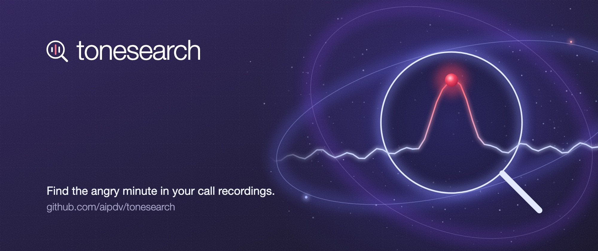
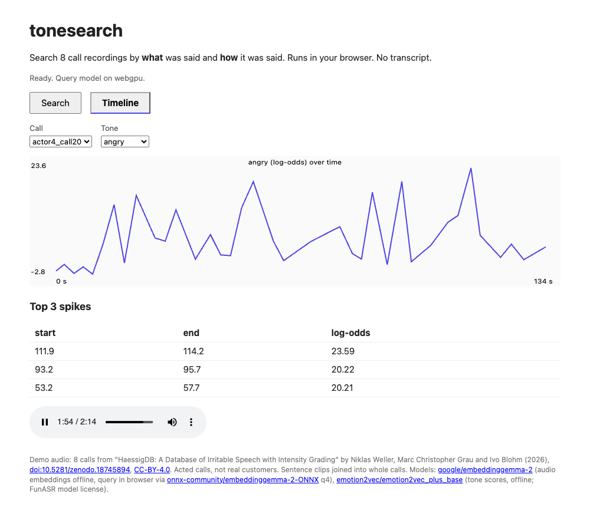

<p align="center"></p>

# tonesearch

Search call recordings by **what** was said and **how** it was said. Runs on your machine. No transcript step.

**[Try the live demo](https://huggingface.co/spaces/pradachan/tonesearch)**: 8 acted support calls, runs in your browser.

<p align="center"></p>

## Why

Call-center QA and voice AI teams have hours of audio. Transcript search finds the words "I want a refund". It does not find the minute where the customer got angry. tonesearch finds both.

## How it works

| Signal | Model | What it gives you |
|---|---|---|
| Words | [EmbeddingGemma 2](https://huggingface.co/google/embeddinggemma-2) | Audio and text in one space, so a text query finds speech by meaning |
| Tone | [emotion2vec+ base](https://huggingface.co/emotion2vec/emotion2vec_plus_base) | A score per segment for angry, sad, happy, neutral and more |

Each segment gets `z(cosine to query) + w * z(tone log-odds)`. Set `w = 0` to search words only. Leave the query empty to search tone only.

## Quick start

Needs Python 3.10+.

```sh
pip install git+https://github.com/aipdv/tonesearch
tonesearch index ./calls ./index                  # .wav .mp3 .flac .m4a .ogg
tonesearch search ./index "refund request" --tone angry
tonesearch search ./index --tone angry            # tone only
tonesearch ui ./index                             # web UI at http://127.0.0.1:7860
```

The UI has two tabs: search with playback, and a tone timeline per call.

## Does it work?

Tested on HaessigDB: 888 acted call-center clips, rated 1 to 10 for irritation. Full numbers in [RESULTS.md](RESULTS.md).

- emotion2vec "angry" score vs human irritation rating: Spearman **+0.54**, zero-shot.
- EmbeddingGemma 2 audio encodes the words about as well as a transcript, but adds no tone. That is why tonesearch uses both models.
- Speed on an M3 Mac: 18x real time with GPU, 3.4x real time on CPU only.

Limits: acted speech, 4 actors. Real calls are noisier.

## Run the demo locally

Download [HaessigDB](https://doi.org/10.5281/zenodo.18745894) (CC-BY-4.0), then:

```sh
python -I make_demo.py <haessig dir>              # joins clips into whole-call WAVs
tonesearch index <haessig dir>/calls <haessig dir>/index
python -I test_tonesearch.py <haessig dir>        # self-check
tonesearch ui <haessig dir>/index
```

## Repo map

| Path | What |
|---|---|
| `tonesearch.py` | Indexer, search, CLI, Gradio UI |
| `make_demo.py`, `test_tonesearch.py` | Demo data builder and self-check |
| `eval_tone.py`, `probe_*.py` | Research scripts behind RESULTS.md |
| `space-static/` | The live in-browser demo (see its README to rebuild) |
| `space/` | Gradio version of the demo |

<details>
<summary>Deploy the demo to Hugging Face</summary>

Static Space (free tier). Build the data, create the Space, then upload with the Python API. `hf upload` re-creates the repo as Gradio and fails with 402 on free accounts.

```sh
python -I space-static/build.py                   # needs space/index and space/calls
hf repos create <hf user>/tonesearch --repo-type space --space-sdk static
python -I -c "from huggingface_hub import HfApi; HfApi().upload_folder(repo_id='<hf user>/tonesearch', repo_type='space', folder_path='space-static')"
```

Gradio Space (needs paid hardware). The demo data is gitignored, so build it first:

```sh
mkdir -p space/calls
for c in actor1_call11 actor1_call13 actor2_call27 actor2_call28 actor3_call40 actor3_call45 actor4_call20 actor4_call21; do cp <haessig dir>/calls/$c.wav space/calls/; done
(cd space && tonesearch index calls index)        # 8 calls, 241 segments, about 27 MB
cp tonesearch.py space/
hf repo create <hf user>/tonesearch --repo-type space --space-sdk gradio
hf upload <hf user>/tonesearch space . --repo-type space
```

Index paths are relative to the index folder, so an index moves with its audio.

</details>

## License note

emotion2vec+ uses the FunASR model license. Check its commercial terms before you use it in a paid product.
