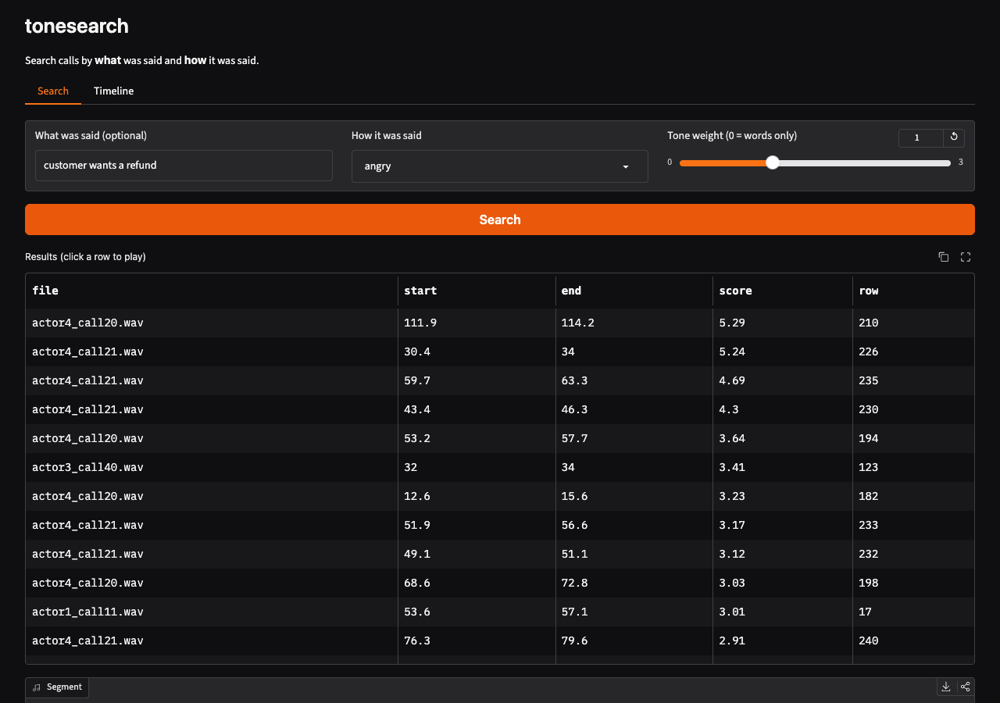
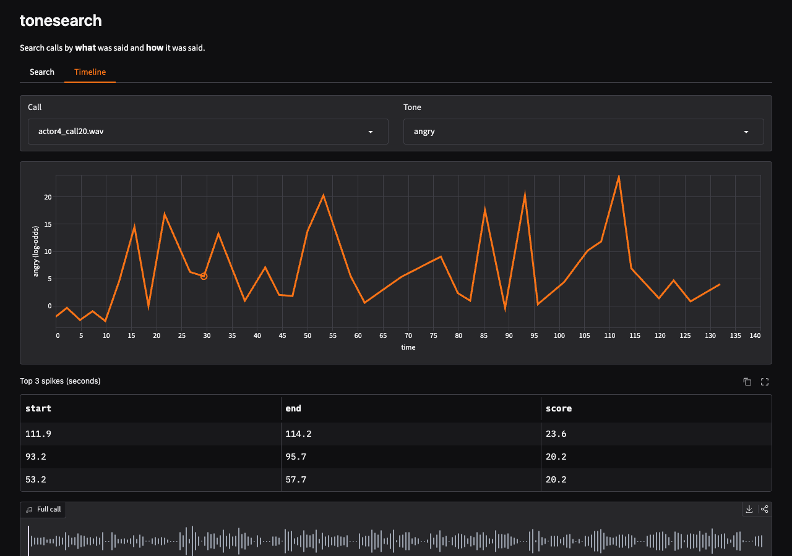

# EmbeddingGemma 2 hears the words in a call, not the tone. emotion2vec fills the gap.

EmbeddingGemma 2 can embed raw audio and text into one vector space. I wanted to use that to search call recordings for angry customers, with a text query and no transcript. Before I built the tool, I tested whether the audio vector carries tone at all.

It mostly does not. On a public set of rated call-center speech, the EmbeddingGemma 2 audio embedding predicts irritation exactly as well as an embedding of the transcript. Almost all of its signal comes from the words. A small speech-emotion model, emotion2vec+ base, picks up the tone with no training.

This post has the numbers, the method, and a small local tool (tonesearch) that uses both models.

## The data

[HaessigDB](https://doi.org/10.5281/zenodo.18745894) (Weller, Grau and Blohm, CC-BY-4.0) has acted call-center speech. I used the 888 sentence clips that ship with audio. They come from 4 actors and 37 calls. Each clip has 1 to 10 ratings for annoyance, frustration and aggression. My target is the mean of the three. I call it irritation.

## The method

- Zero-shot scores: For EmbeddingGemma 2, the cosine between each clip and the text query "angry customer". For emotion2vec+, its "angry" score.
- Linear probes: Ridge regression on the embeddings, leave-one-actor-out. The test voice is never in the training set.
- Beyond words: I fit the same probe on the EmbeddingGemma 2 text embedding of each clip's transcript. Then I take the part of the irritation rating that the transcript does not explain. "Beyond words" is the Spearman correlation of each signal with that leftover. A signal that only knows the words scores near zero.
- Loudness: Mean RMS, z-scored inside each call, as a simple baseline.
- AUC compares the top 25% of clips by irritation with the bottom 25%.

## The results

| Signal | Spearman | AUC | Beyond words |
|---|---|---|---|
| EG2 audio, text query "angry customer" | +0.36 | 0.78 | +0.11 |
| EG2 audio embedding, ridge probe | +0.45 | 0.84 | +0.06 |
| EG2 transcript embedding, ridge probe | +0.45 | 0.84 | n/a |
| Loudness | +0.42 | 0.79 | +0.41 |
| emotion2vec+ base, "angry" score, zero-shot | +0.54 | 0.88 | +0.54 |
| emotion2vec+ embedding, ridge probe | +0.57 | 0.91 | +0.54 |
| emotion2vec+ and EG2 audio, ridge probe | +0.66 | 0.94 | +0.45 |

Three things stand out.

1. The EG2 audio probe and the EG2 transcript probe score the same (+0.45, AUC 0.84). The audio probe adds +0.06 beyond words. So the audio vector encodes what was said, about as well as a transcript, and very little of how it was said.
2. Plain loudness beats the EG2 audio vector on tone.
3. emotion2vec+ zero-shot gets +0.54, and all of it is beyond words. Inside one call, its angry score follows the escalation: median Spearman +0.41 over 37 calls.

I do not read this as a flaw in EmbeddingGemma 2. A retrieval embedding should map "I want a refund" to the same place, whether you say it calmly or shout it. For tone, you need a second model.

## A small fix: softmax ties

emotion2vec+ returns softmax scores. When I indexed 60 minutes of calls (1176 segments), 133 segments scored exactly 1.0 for "angry". The top of every angry search was a tie.

I rank on log-odds now: `log p[label] - mean(log p)`. This recovers the logit gap, which does not saturate.

| Tone-only "angry" ranking, 1176 segments | Spearman | Mean irritation, top 10 |
|---|---|---|
| Softmax score | +0.50 | 7.19 |
| Log-odds | +0.52 | 7.54 |

## The tool: tonesearch

tonesearch uses each model for its own job. It splits each call on silence into 2 to 10 second segments. EmbeddingGemma 2 embeds each segment. emotion2vec+ scores each segment for tone. Both go into one `.npz` file. A search is:

```
score = z(cosine(query, segment)) + w * z(tone log-odds)
```

`w = 0` searches by words only. An empty query searches by tone only. A Gradio UI shows the results, plays each segment, and plots the tone over one call.





## Run it locally

```sh
git clone <repo URL>   # TODO-LINK: repo is private now
cd tonesearch
pip install -e .
tonesearch index <audio dir> <index dir>   # any .wav .mp3 .flac .m4a .ogg
tonesearch search <index dir> "refund request" --tone angry --w 1
tonesearch ui <index dir>                  # http://127.0.0.1:7860
```

To rebuild the HaessigDB demo and its self-check:

```sh
python -I make_demo.py <haessig dir>
tonesearch index <haessig dir>/calls <haessig dir>/index
python -I test_tonesearch.py <haessig dir>
```

Speed on an M3 Mac: 18x real time with EmbeddingGemma 2 on the GPU (MPS), and 3.4x real time on CPU only. EmbeddingGemma 2 is the slow part on CPU. An int8 ONNX build of its audio encoder is the next step.

<!-- TODO-LINK: Hugging Face Space demo URL, once deployed. -->

## Limits

- The speech is acted and scripted. Real calls have more noise and cross-talk.
- Only 4 actors.
- I tested one emotion model and one embedding model.
- emotion2vec+ uses the FunASR model license. Check its terms before commercial use.

## Why local

Call audio is private data. Both models are open-weight and run on a laptop, so the audio never leaves the machine. Open weights also made this test possible. I needed the raw vectors and logits to run the probes. A hosted API that returns only a label would not have shown that the audio vector carries words and not tone.
